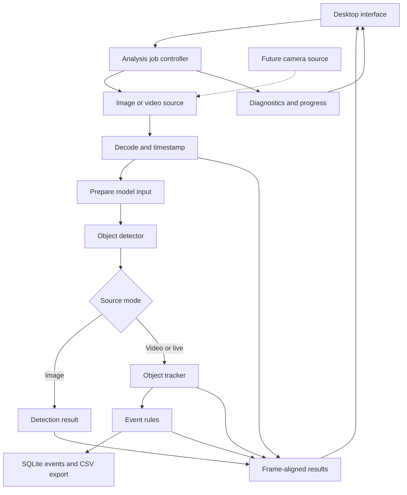

# Architecture sketch

## Overall structure

Implementation snapshot: `MediaReader`, owned RGB `Frame` values, exports, CLI, `PreviewSession`, Qt preview, and `Tracker` exist. PreviewSession owns one ordered worker and a two-frame queue; source generations reject stale frames. YOLOX-Nano CPU detection, tracking, and finite-line rules run sequentially on that worker; each queued frame carries its own optional detection/tracking result. The tracker keeps per-track crossing state, bounded trails, and cumulative counters. Persistent storage and the full analysis-job contract below remain target architecture. See [development](DEVELOPMENT.md) and [tracking](TRACKING.md).

Separate the processing core from the desktop interface. The interface configures jobs and displays results; decoding and inference run off its event thread. The CLI uses the same media core for repeatable inspection.

## Responsibilities

| Module | Owns | Why it is separate |
| --- | --- | --- |
| Job controller | Run ID, configuration snapshot, lifecycle, cancellation | One place defines start, finish, failure, and restart |
| Source/decoder | File or camera handle, decoded frames, timestamps | New inputs can be added without changing event logic |
| Preprocessor | Resizing, colour conversion, normalisation, coordinate transform | Model coordinates must map back to the displayed frame |
| Detector | Model session and model-specific output conversion | Model replacement stays behind a stable detection contract |
| Tracker | Active tracks, association, lost-track expiry | Detections in individual frames do not imply identities |
| Event engine | Rule configuration and per-track crossing state | Counting is a temporal rule rather than a detector output |
| Storage/export | Run metadata, events, schema version, CSV output | Persistence should not depend on UI widgets |
| Presentation | Playback, drawing, event navigation | Rendering must not block processing |
| Diagnostics | Stage timings, queue depth, frame drops, memory observations | Optimization needs measurements |

## Proposed data contracts

These describe the full target, not a final database schema. The implemented `Frame` contains sequence, optional timestamp, dimensions, stride, and owned RGB pixels; `PreviewFrame` adds a generation ID. Source/run identities and analysis result contracts will be introduced with analysis jobs.

- **Frame:** source ID, run ID, generation ID, frame sequence, source-relative timestamp, dimensions, pixel format, row stride, and owned pixel storage. For live input also record monotonic arrival time and optional wall-clock time.
- **Detection:** frame identity, class, confidence, and bounding box in original-frame coordinates.
- **Track:** run-scoped track ID, class, bounding box, chosen anchor point, timestamp, and tracking state.
- **Event:** unique event ID, run ID, rule ID, track ID, class, crossing direction, source timestamp, frame identity, and optional thumbnail reference.
- **Run:** source reference, model identifier/checksum, model settings, rule snapshot, start/end state, and summary measurements.

A timestamp says when a frame belongs in the source; a processing timer says how long computation took. They are different clocks. For variable-frame-rate recordings, use decoded presentation timestamps rather than deriving time from frame number divided by nominal FPS.

## Frame ownership and concurrency

Begin with a small number of workers: decoding, sequential analysis, and persistence, alongside the UI thread. Detection, tracking, and event evaluation initially remain in one ordered analysis worker. Add parallel inference only if profiling justifies it, with an explicit ordering mechanism before tracking.

Decoded frames have a clear owner and remain valid until their consumers finish. Prefer moving ownership or sharing read-only storage where appropriate. Do not promise zero copies: colour conversion and model tensor preparation may need additional buffers. FFmpeg-owned memory must not be freed while another stage still references it.

Every queue has a fixed capacity and a documented overload policy:

| Mode | Policy |
| --- | --- |
| Offline analysis | Apply backpressure; preserve frames even if analysis is slower than playback |
| Live analysis | Discard stale queued frames to bound latency; record the drops |
| Current file preview | Apply backpressure and preserve decoded order in a two-frame queue |
| Future analysis preview | Prefer a recent frame; previews may skip independently of offline analysis |
| Event persistence | Preserve events; report storage failure explicitly instead of silently losing them |

Live dropped frames reduce temporal evidence and can reduce counting accuracy. Tracking uses elapsed timestamps and tolerates gaps within configured limits; performance reporting must include drops.

The display matches results by source generation, analysis revision, and frame identity. Settings edits preserve the decoder position, re-analyse the held/buffered pixels in source order, and reset track/rule state at the current position. Older revisions cannot overwrite the refreshed frame. The player Stop is a resumable pause; source replacement and close use cancellation. Persistent review playback and seeking remain a later separate session.

## Initial crossing rule

Use a configurable line with two endpoints normalized to the original frame dimensions. The box bottom-center is the baseline anchor. A candidate crossing must intersect the finite line segment, pass direction filtering, and satisfy a small deadband/hysteresis around the boundary to avoid jitter-driven counts. The implemented rules require three observations for confirmation and invalidate crossing history across long gaps; exact defaults are in [TRACKING.md](TRACKING.md).

Repeat crossings are allowed after a later same-side observation moves beyond the re-arm distance. Current event IDs increase within one run; Phase 5 must add persistent run identity and idempotent event writes. Track loss and identity switches can still create missed or duplicate counts; evaluate those cases rather than assuming IDs are perfect.

## Persistence and review

Plan for runs, rule snapshots, events, and optional thumbnail files. SQLite holds structured metadata; keep large images outside database rows initially. Use a single writer and transactions, and introduce schema versioning with the first schema.

Persist source-relative timestamps and the original source reference. If the source file has moved or disappeared, review should explain that it cannot open the footage. Saving events does not copy the source video. Live replay requires a later recording/retention design.

## Failure and shutdown

Useful errors distinguish unsupported media, missing model, malformed model output, decode failure, cancelled analysis, exhausted device resources, and storage failure. Cancellation must wake blocked queues. Workers stop and join before their buffers and native handles are destroyed. Finishing a file drains accepted work before marking the run complete.

## Language and library boundaries

C++20 is the proposed application language. Use RAII wrappers for C resources: destruction releases handles and memory automatically, including on early returns. Keep model-specific and library-specific structures inside adapters where practical. Do not force a custom C layer before there is a demonstrated requirement.

FFmpeg decodes, Qt presents the interface, and ONNX Runtime runs YOLOX-Nano on the CPU. Native C++ handles preprocessing and postprocessing. OpenCV is not needed for the current adapter; SQLite remains planned. Avoid implementing overlapping playback stacks until there is a reason to do so.

## Optional training and service boundary

Training is an offline artifact-production workflow, not part of the desktop process. A future Python tool may train on a workstation or bwUniCluster and export a versioned ONNX model plus labels, preprocessing metadata, checksum, metrics, and provenance. The C++ application accepts that artifact only through a matching detector adapter and local validation.

A future GPU execution provider remains inside the native detector boundary. A future Python inference worker, if justified, implements the same frame/result identity contract across a versioned process boundary. The native CPU detector remains the fallback. bwUniCluster is a scheduled batch target and is not part of the interactive runtime topology. See [Compute, training, and bwUniCluster](COMPUTE_AND_TRAINING.md).
