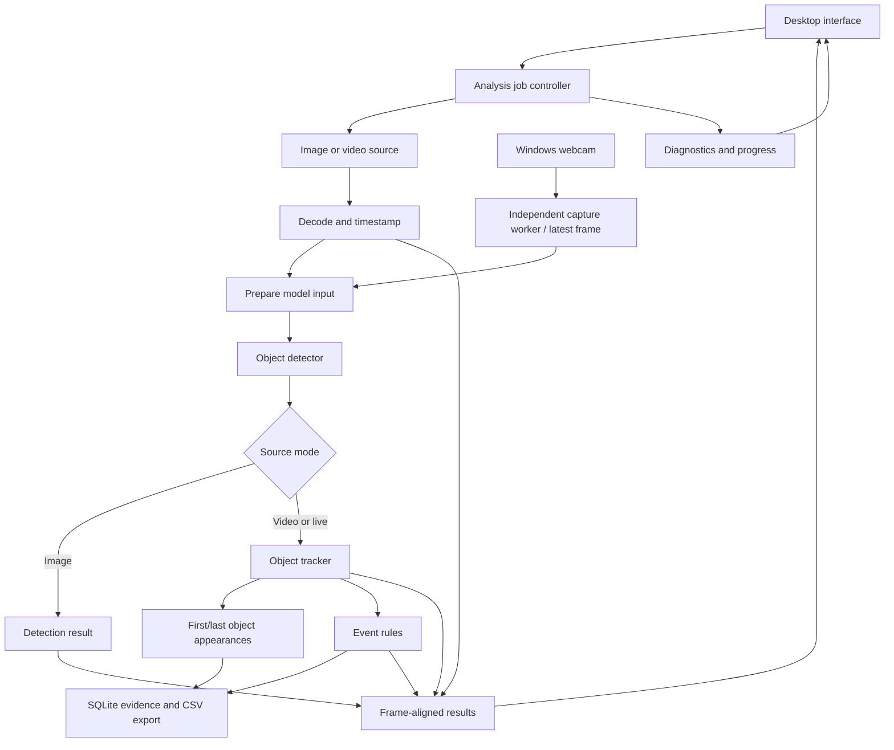

# Architecture sketch

## Overall structure

Implementation snapshot: `MediaReader`, owned RGB `Frame` values, exports, CLI, `PreviewSession`, Qt preview, `Tracker`, `AnalysisJob`, and `RunStore` exist. PreviewSession owns one ordered worker and a two-frame queue; source generations reject stale frames. Selectable YOLOX-Nano/S CPU detection, tracking, and finite-line rules run sequentially. A separate AnalysisJob analyses a full file with frozen settings and commits progress/appearances or crossing events to SQLite. SavedRunWindow pages stored evidence and uses a decode-only PreviewSession for source review. See [development](DEVELOPMENT.md), [tracking](TRACKING.md), and [saved runs](SAVED_RUNS.md).

Separate the processing core from the desktop interface. The interface configures jobs and displays results; decoding and inference run off its event thread. The CLI uses the same media core for repeatable inspection.

## Responsibilities

| Module | Owns | Why it is separate |
| --- | --- | --- |
| Job controller | Run ID, configuration snapshot, lifecycle, cancellation | One place defines start, finish, failure, and restart |
| Source/decoder | File or camera handle, decoded frames, timestamps | New inputs can be added without changing event logic |
| Preprocessor | Resizing, colour conversion, normalisation, coordinate transform | Model coordinates must map back to the displayed frame |
| Detector | Model session and model-specific output conversion | Model replacement stays behind a stable detection contract |
| Tracker | Active tracks, association, lost-track expiry | Detections in individual frames do not imply identities |
| Event engine | Rule configuration and per-track crossing state | Counting is a temporal rule rather than a detector output |
| Storage/export | Run metadata, events, schema version, CSV output | Persistence should not depend on UI widgets |
| Presentation | Playback, drawing, event navigation | Rendering must not block processing |
| Diagnostics | Stage timings, queue depth, frame drops, memory observations | Optimization needs measurements |

## Proposed data contracts

The list below describes the wider target. Implemented `Frame` contains sequence, optional timestamp, dimensions, stride, and owned RGB pixels; `PreviewFrame` adds generation/revision IDs. One saved-run file currently supplies the run namespace. Its configuration, appearances and crossing events use schema version 3 (versions 1/2 remain readable), described in [saved runs](SAVED_RUNS.md).

- **Frame:** source ID, run ID, generation ID, frame sequence, source-relative timestamp, dimensions, pixel format, row stride, and owned pixel storage. For live input also record monotonic arrival time and optional wall-clock time.
- **Detection:** frame identity, class, confidence, and bounding box in original-frame coordinates.
- **Track:** run-scoped track ID, class, bounding box, chosen anchor point, timestamp, and tracking state.
- **Appearance:** run-scoped tracker ID, class, first/last source observations, observation count, confidence and first-frame thumbnail.
- **Event:** unique event ID, run ID, rule ID, track ID, class, crossing direction, source timestamp, frame identity, and optional thumbnail reference.
- **Run:** source reference, model identifier/checksum, model settings, rule snapshot, start/end state, and summary measurements.

A timestamp says when a frame belongs in the source; a processing timer says how long computation took. They are different clocks. For variable-frame-rate recordings, use decoded presentation timestamps rather than deriving time from frame number divided by nominal FPS.

## Frame ownership and concurrency

Use a small number of workers alongside the UI thread. Detection, tracking, event evaluation, and persistence remain in one ordered AnalysisJob worker. The UI polls compact progress and a replaceable analysed-preview snapshot published at most every 200 ms, rather than receiving an accumulating frame/result log. Source review uses the existing bounded PreviewSession with inference disabled. Add parallel inference only if profiling justifies it, with explicit ordering before tracking.

Decoded frames have a clear owner and remain valid until their consumers finish. Prefer moving ownership or sharing read-only storage where appropriate. Do not promise zero copies: colour conversion and model tensor preparation may need additional buffers. FFmpeg-owned memory must not be freed while another stage still references it.

Every queue has a fixed capacity and a documented overload policy:

| Mode | Policy |
| --- | --- |
| Offline analysis | Apply backpressure; preserve frames even if analysis is slower than playback |
| Live analysis | Discard stale queued frames to bound latency; record the drops |
| Current file preview | Apply backpressure and preserve decoded order in a two-frame queue |
| Analysis preview | Capacity-one recent snapshot; previews skip independently of ordered offline processing |
| Event persistence | Preserve events; report storage failure explicitly instead of silently losing them |

The implemented live path uses `LiveSession`: capture feeds a capacity-one latest-frame slot, and ordered CPU analysis feeds a capacity-one latest-result slot. Both replacements are counted. Frames retain monotonic application-arrival gaps for tracking; stop/error shuts down both workers and releases the source. See [live camera](LIVE_CAMERA.md). Driver buffers and in-flight processing add memory beyond these slots.

Live dropped frames reduce temporal evidence and can reduce counting accuracy. Tracking uses elapsed timestamps and tolerates gaps within configured limits; performance reporting must include drops.

The display matches results by source generation, analysis revision, and frame identity. Player settings edits preserve the decoder position, re-analyse held/buffered pixels in order, and reset temporary track/rule state. Older revisions cannot overwrite the refreshed frame. Stop is a resumable pause; source replacement and close use cancellation. Saved source review is a separate decode-only session that cannot reconfigure analysis or obtain a SQLite writer.

## Initial crossing rule

Use a configurable line with two endpoints normalized to the original frame dimensions. The box bottom-center is the baseline anchor. A candidate crossing must intersect the finite line segment, pass direction filtering, and satisfy a small deadband/hysteresis around the boundary to avoid jitter-driven counts. The implemented rules require three observations for confirmation and invalidate crossing history across long gaps; exact defaults are in [TRACKING.md](TRACKING.md).

Repeat crossings are allowed after a later same-side observation moves beyond the re-arm distance. Event IDs increase within one run. Each saved file namespaces those IDs; identical repeated writes are ignored and conflicting IDs fail transactionally. This prevents storage duplicates; track loss and identity switches can still create incorrect counting events and require labelled evaluation.

## Persistence and review

RunStore saves one frozen run/configuration snapshot with appearances or crossing events in a schema-3 SQLite file. A single worker writes evidence plus progress in transactions. Schema guards preserve read-only compatibility with versions 1/2. Small thumbnails (at most 160×90 RGB PPM) are embedded for portable evidence; full frames/video stay outside the database. Review/export open the database read-only and page at most 100 entries. Completed, cancelled, failed, and unfinished runs remain distinct. New GUI analyses use a unique temporary database, show results before saving, and copy/export atomically on request. Unsaved results require a Save/Discard/Cancel choice before replacement or close. Thumbnails are generated at appearance starts; later observations update first/last summaries without rewriting the thumbnail.

Persist source-relative timestamps and the original source reference. If the source file has moved or disappeared, review should explain that it cannot open the footage. Saving events does not copy the source video. Live replay requires a later recording/retention design.

## Failure and shutdown

Useful errors distinguish unsupported media, missing model, malformed model output, decode failure, cancelled analysis, exhausted device resources, and storage failure. Cancellation must wake blocked queues. Workers stop and join before their buffers and native handles are destroyed. Finishing a file drains accepted work before marking the run complete.

## Language and library boundaries

C++20 is the proposed application language. Use RAII wrappers for C resources: destruction releases handles and memory automatically, including on early returns. Keep model-specific and library-specific structures inside adapters where practical. Do not force a custom C layer before there is a demonstrated requirement.

FFmpeg decodes, Qt presents the interface, ONNX Runtime runs YOLOX-Nano or YOLOX-S on the CPU, and SQLite stores run/event evidence. SQLite's pinned amalgamation is compiled as C and wrapped with C++ ownership. Native C++ handles preprocessing, postprocessing, and small thumbnails. OpenCV is not needed for the current adapter. Preview and review share the bounded decoder controller.

## Optional training and service boundary

Training is an offline artifact-production workflow, not part of the desktop process. A future Python tool may train on a workstation or bwUniCluster and export a versioned ONNX model plus labels, preprocessing metadata, checksum, metrics, and provenance. The C++ application accepts that artifact only through a matching detector adapter and local validation.

A future GPU execution provider remains inside the native detector boundary. A future Python inference worker, if justified, implements the same frame/result identity contract across a versioned process boundary. The native CPU detector remains the fallback. bwUniCluster is a scheduled batch target and is not part of the interactive runtime topology. See [Compute, training, and bwUniCluster](COMPUTE_AND_TRAINING.md).

## Optional GPU module in 0.10

`Detector` retains shared preprocessing/postprocessing and coordinates. `DmlInference` owns a private module, API table, adapter choice, session and tensor resources; no GPU handles enter Qt, tracking or storage. The linked CPU runtime stays independent. Automatic mode retries a failed GPU frame once on CPU and then remains there, while cancellation bypasses fallback. Source/generation identity and ordered handoff remain unchanged.

`ExecutionInfo` reports actual provider, runtime, device and fallback separately from requested `DetectorBackend`. The worker records changes in optional schema-3 metadata; the reader detects columns rather than migrating existing files. The main player passes its device preference into the otherwise unchanged saved-analysis window. Explicit GPU hardware tests and comparison tooling exercise the module; see [details](GPU_INFERENCE.md).

## Tracking continuity modules (0.11)

`Tracker` stays pixel independent. `FrameTracker` composes a bounded `SceneBoundary` guard with association/rules and is shared by preview, live, CLI and appearance analysis. A boundary clears active continuity while retaining monotonically increasing run IDs and counts. `association::assign` owns the bounded experimental Hungarian repair; the default remains greedy. Optional schema-3 policy metadata preserves configuration without migrating older files. See [evaluation](TRACKING_EVALUATION.md).
