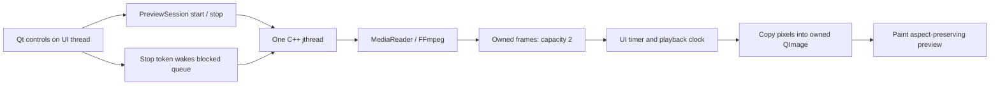

# Build and understand FrameTrail

## What runs today

FrameTrail 0.3 has a desktop preview and a command-line media inspector backed by a reusable C++ library. Both open local images and recordings, decode the visual stream, and produce owned RGB24 pixels with source timestamps. The desktop displays frames; the CLI exports metadata to CSV and the first frame to a lossless PPM image.

The preview has Open media, Play/Pause, Stop, and Replay. CPU detection now adds boxes, labels, confidence filtering, and detection CSV exports; see [the detection guide](DETECTION.md). Audio playback, seeking, tracking, event storage, live input, and agents remain planned. Without detection, CLI throughput measures decoding/export. With `--detect`, it includes inference and reports detection timing separately. Neither is a live-performance promise.

## Windows setup

Requirements: Windows x64, Visual Studio 2022 with Desktop development with C++ and its Windows SDK, CMake 3.25 or newer, and PowerShell. The scripts discover Visual Studio's bundled CMake without changing PATH.

From the FrameTrail repository directory:

```powershell
.\scripts\fetch-dependencies.ps1
.\scripts\build.ps1
.\build\windows-msvc\Release\frametrail-desktop.exe
```

Fetching downloads approximately 81 MB of FFmpeg and 40 MB of Qt base into `.deps/`, verifies SHA-256 hashes against the committed manifests, and extracts the SDKs. CMake's archive utility handles Qt's 7z archive, so no separate 7-Zip installation is needed. It also fetches ONNX Runtime (about 83 MB) and YOLOX-Nano (about 3.6 MB). Nothing is installed system-wide. Building configures x64, compiles Release, copies runtime DLLs and Qt platform plugins beside the executables, and runs CTest checks (eight with the model, eleven after fetching the optional detection sample).

For Debug:

```powershell
.\scripts\build.ps1 -Configuration Debug
```

To build only the core and CLI without acquiring Qt (CPU detection remains included):

```powershell
.\scripts\fetch-dependencies.ps1 -MediaOnly
.\scripts\build.ps1 -MediaOnly
```

## Opening a fresh copy in VS Code

Each clone needs its own SDKs: `.deps/` is ignored by Git. Selecting a compiler/preset does not download dependencies. Run `./scripts/fetch-dependencies.ps1` before the first configure.

Choose **Windows x64 (Visual Studio 2022)** (`windows-msvc`). Visual Studio supplies the compiler; VS Code is the editor. Run **CMake: Configure**, choose the `release` or `debug` build preset, and run **CMake: Build**. Select `frametrail-desktop` as the launch target. The [CMake Tools preset guide](https://github.com/microsoft/vscode-cmake-tools/blob/main/docs/cmake-presets.md) explains these commands.

If paused inside `CMakeLists.txt` on a `find_path` error, stop the CMake debugging session, fetch dependencies, and configure normally. Missing `libavcodec/avcodec.h` means the FFmpeg development SDK is absent or `FFMPEG_ROOT` is wrong. Installing only `ffmpeg.exe` does not provide development headers/libraries. Missing `Qt6Config.cmake` requires the Qt SDK too.

The build script performs configure/build/checks together. Stop any active CMake session before running it against the same build directory.

If CMake is on PATH, manual equivalents are:

```powershell
cmake --preset windows-msvc
cmake --build --preset release
ctest --preset release
```

Custom compatible SDKs can be specified through `-DFFMPEG_ROOT=<ffmpeg-directory>` and `-DFRAMETRAIL_QT_ROOT=<qt-directory>`. CLI-only configuration uses `-DFRAMETRAIL_BUILD_GUI=OFF`. The convenience build script intentionally uses the manifests' SDK paths and refreshes both root paths on each configure.

## Using the desktop

Use **Open media** to select a local file. Videos start automatically. **Pause** holds the frame, **Play** resumes, **Stop** cancels decoding and leaves the last image visible, and **Replay** starts the same source from the beginning. Opening another file cancels the old worker before starting the new source. Closing requests cancellation and waits for the worker without blocking the UI event thread.

The window shows dimensions, codec, zero-based frame number, and source-relative timestamp. A synthetic example is available after tests generate the fixtures:

```powershell
.\build\windows-msvc\Release\frametrail-desktop.exe .\build\windows-msvc\fixtures\variable.mkv
```

This test pattern is deliberately tiny (64x48, ten frames), so enlarging it looks pixelated. Try a real recording for a useful preview. Playback uses decoded presentation timestamps and preserves order. If decoding falls behind, playback slows instead of dropping frames. Unknown timestamps use an approximately 30 FPS display fallback but remain unknown in the frame contract and CSV. Still images remain displayed after the source finishes.

## Using the inspector

```powershell
.\build\windows-msvc\Release\frametrail.exe --help
.\build\windows-msvc\Release\frametrail.exe inspect .\build\windows-msvc\fixtures\variable.mkv
New-Item -ItemType Directory -Path output -Force
.\build\windows-msvc\Release\frametrail.exe inspect "C:\Videos\entrance.mp4" --csv output\frames.csv --preview output\first-frame.ppm --max-frames 100
```

Replace the example input with your recording. Output directories must exist; existing output files are refused. Choose fresh names for subsequent exports. A failed decode/write may leave partial output, and a nonzero exit status indicates failure.

Without `--max-frames`, inspection reads to EOF. `timestamp_us` is source-relative presentation time in microseconds (one million per second); unknown timing stays blank. Initial metadata dimensions may differ from individual frames. The desktop can open the exported PPM image.

## Source map

| Location | Responsibility |
| --- | --- |
| `include/frametrail/frame.hpp` | Sequence, optional timestamp, dimensions, stride, owned pixels |
| `include/frametrail/media_reader.hpp`, `src/media_reader.cpp` | Local file validation, FFmpeg ownership, decoding/flushing, timing, RGB conversion |
| `src/frame_export.cpp` | PPM writing with row padding |
| `include/frametrail/preview_session.hpp`, `src/preview_session.cpp` | Worker lifecycle, cancellation, bounded queue, status, source generations |
| `apps/desktop/preview_window.cpp` | Controls, playback clock, generation checks, image ownership, painting |
| `apps/desktop/main.cpp` | Qt entry point and optional initial file argument |
| `apps/cli/main.cpp` | Arguments, export validation, frame loop, CSV, summary |
| `include/frametrail/detector.hpp`, `src/detector.cpp` | Model session, preprocessing, grid decoding, NMS, labels, and CPU timings |
| `tests/` | Synthetic fixtures, media/CLI/worker/desktop behaviour checks |
| `scripts/` | Explicit dependency acquisition and build/check commands |
| `dependencies/` | Pinned FFmpeg, Qt, ONNX Runtime, and model artifacts |

FFmpeg is a C library called directly from our C++ code. RAII wrappers release native contexts, packets, frames, and conversion resources even when an operation fails. Returned frames own their pixels and remain valid when the reader advances. At EOF the reader flushes delayed decoder output, which matters for codecs that reorder frames internally.

## Worker, timing, and ownership



With detection enabled, the same worker runs inference after decoding, then enqueues the frame and its detections together. The worker never touches Qt widgets. A mutex protects status and the queue. A stop-aware condition variable waits when the queue is full; the UI polls without waiting for frames. Pause leaves a bounded backlog instead of decoding the entire recording into memory.

Each start increments a generation ID. The display rejects frames from earlier sources. Replacement waits for the previous worker to become inactive and joins it before starting another. Stop clears queued frames and wakes the producer. `std::jthread` is the last session member so destruction joins before synchronization objects disappear. Decoding can finish before playback: the UI reaches Finished only after the accepted frames are displayed.

Application frame storage includes at most two queued frames, one pending presentation frame, and the displayed QImage, plus decoder/conversion buffers and temporary copies. The deliberate QImage copy prevents dangling pixels. This bounds frame count, not bytes: larger resolutions use more memory. Profiling may justify reducing copies later.

Source presentation timestamps govern playback; a steady clock measures elapsed playback time. Pause shifts the playback clock's anchor. The reader is sequential and must not be read concurrently. Its stop token interrupts FFmpeg I/O; the CLI currently relies on OS process interruption rather than a graceful interactive cancel command.

## Checks and limitations

The original six checks cover fixture generation, media contracts, CLI help, CLI exports, preview lifecycle, and desktop controls. Detection adds contract and real-model checks, plus three optional reference-sample checks described in [DETECTION.md](DETECTION.md). Media checks verify colour/layout, retained ownership, delayed EOF, variable timing, cancellation, invalid/audio-only inputs, Unicode paths, and padded export. CLI checks cover CSV rows, limits, and output protection. Worker checks cover queue bounds, blocked-producer cancellation, generations, ordered EOF, failure recovery, and shutdown. Desktop checks exercise pixels, pause/resume, stop, replay, replacement, errors, and closing with an active worker.

Desktop checks use Qt's offscreen platform and load the installed Windows Segoe UI font for readable screenshots. The rendered window was inspected, but native file-dialog interaction and representative long recordings still need manual checks. No leak detector or sustained live-input test has been run. Windows x64 is the verified platform.

Audio, seeking, rotation metadata, and non-square sample aspect-ratio correction are not implemented. The canvas preserves pixel-dimension aspect ratio. Supported codecs depend on the FFmpeg build; every possible format has not been verified. Memory growth and representative performance still need measurement.

## Dependency provenance

FFmpeg is an LGPL-shared 8.1 branch build from [BtbN/FFmpeg-Builds](https://github.com/BtbN/FFmpeg-Builds). The pinned September 2026 monthly build has longer retention than daily archives, but availability is finite. Qt 6.11.3 base comes from the [official SDK repository](https://download.qt.io/online/qtsdkrepository/windows_x86/desktop/qt6_6113/). Neither script silently falls back to an unpinned latest archive.

Licenses/notices remain inside `.deps`. Local development builds do not complete the distribution milestone; packaging needs the selected binaries' notices and licensing review. See [equipment and setup](EQUIPMENT_AND_SETUP.md).

## Next slice

Evaluate the implemented CPU detector on representative people/vehicle clips, then build tracking and crossing rules from those observations. Event review and seeking follow later. Optional AI perception and an agent-driven service remain deferred.
