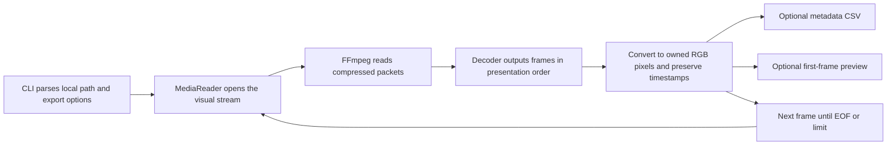

# Build and understand the first codebase

## What runs today

FrameTrail 0.1 is a command-line media inspector backed by a reusable C++ library. It opens a local image or recording, decodes its visual stream, converts frames to RGB24, and reports their timestamps. It can export frame metadata to CSV and the first frame to a lossless PPM image.

This establishes the media foundation. There is no desktop window, object detector, tracker, event database, live camera, or agent yet. The current throughput number measures decoding and optional export; it is not an AI benchmark or a promise about live video performance.

## Windows setup

Requirements: Windows x64, Visual Studio 2022 with Desktop development with C++ and its Windows SDK, CMake 3.25 or newer, and PowerShell. CMake bundled with Visual Studio can be used without changing PATH.

From the FrameTrail repository directory:

```powershell
.\scripts\fetch-dependencies.ps1
.\scripts\build.ps1
```

The first command downloads approximately 81 MB into `.deps/`, checks the SHA-256 against the committed dependency manifest, and extracts the SDK. It performs no system installation. The second discovers CMake, configures an x64 Visual Studio build, compiles Release, and runs CTest. It copies the SDK's DLLs beside the development executables.

For a Debug build:

```powershell
.\scripts\build.ps1 -Configuration Debug
```

If CMake is already on PATH, equivalent manual commands are:

```powershell
cmake --preset windows-msvc
cmake --build --preset release
ctest --preset release
```

For an independently provisioned compatible FFmpeg SDK, configure with `-DFFMPEG_ROOT=<sdk-directory>` using CMake directly. The convenience build script intentionally uses the committed manifest's SDK. If the manifest changes, use the build script to update the configured SDK path.

## Try the inspector

After the build, tests have generated tiny synthetic media under `build/windows-msvc/fixtures/`. They require no external footage and are not committed.

```powershell
.\build\windows-msvc\Release\frametrail.exe --help
.\build\windows-msvc\Release\frametrail.exe inspect .\build\windows-msvc\fixtures\still.png
.\build\windows-msvc\Release\frametrail.exe inspect .\build\windows-msvc\fixtures\variable.mkv
```

For your own media and exports:

```powershell
New-Item -ItemType Directory -Path output -Force
.\build\windows-msvc\Release\frametrail.exe inspect "C:\Videos\entrance.mp4" --csv output\frames.csv --preview output\first-frame.ppm --max-frames 100
```

Replace the example input with a real file. Existing output files are refused: choose fresh names for another run. The source is never intentionally overwritten. Export directories must already exist. Files can remain partially written if processing or disk writes fail; a nonzero exit status indicates failure rather than a complete export.

`--max-frames` limits how much work to perform. With no limit the inspector reads to EOF. It prints whether it stopped at the frame limit or EOF. Frames are numbered from zero. `timestamp_us` is source-relative presentation time in microseconds (one million microseconds per second). Missing timing stays blank in CSV instead of being invented from an FPS estimate. Duration and codec dimensions are initial metadata; actual dimensions are recorded on each frame.

PPM is a simple RGB image format used here to verify pixels. It is not the planned final thumbnail format. To view the generated preview in a PNG-only viewer, use the SDK's FFmpeg tool to convert it; future UI work will display frames directly.

## How the code works



| Location | Responsibility |
| --- | --- |
| `include/frametrail/frame.hpp` | The frame contract: sequence, optional timestamp, dimensions, stride, and pixels |
| `include/frametrail/media_reader.hpp` | Public reader interface and metadata; hides FFmpeg implementation details |
| `src/media_reader.cpp` | File validation, native C APIs, handle ownership, decode/flush loop, timing, RGB conversion |
| `src/frame_export.cpp` | PPM writing, including correct handling of row padding |
| `apps/cli/main.cpp` | CLI arguments, output validation, frame loop, metadata export, and summary |
| `tests/` | Synthetic input generation and behaviour checks |
| `scripts/` | Explicit dependency acquisition and build/test commands |
| `dependencies/windows-ffmpeg.json` | SDK version, provider, dated URL, checksum, and archive layout |

FFmpeg is a C library; our code calls its native APIs directly. Small C++ ownership wrappers release its contexts, packets, frames, and conversion resources. Each returned frame owns its RGB buffer, so retaining it remains safe when the reader advances. The inspector holds only the current frame unless a caller explicitly retains more.

The reader first drains available decoder output. When it needs input it sends another packet from the selected visual stream. At file EOF it sends a flush signal and continues receiving delayed frames. This matters for codecs that reorder frames internally.

A `std::stop_token` lets a future job controller cancel reads and interrupt FFmpeg I/O. The current CLI has no graceful interactive cancel command; OS process interruption remains available. The library is sequential and not safe for concurrent reads on the same instance. Worker queues, run IDs, and generation IDs belong to the next asynchronous stage.

## Checks and their limits

CTest verifies RGB layout/colour, retained-frame ownership, delayed-frame EOF flushing, variable presentation timing, repeated opening, cancellation before opening/between reads, invalid and audio-only inputs, Unicode paths, padded-frame export, CSV rows, frame limits, and refusal to replace existing output.

These checks are not a leak-detector run or a sustained live-input test. Initial build scripts and runtime layout are validated on Windows x64; other operating systems are not verified. The reader ignores audio, does not seek or play at wall-clock speed, and does not apply orientation metadata or aspect-ratio display correction. Supported codecs come from the chosen FFmpeg build; we have not verified every possible media format.

## Dependency provenance

The development SDK is an LGPL-shared FFmpeg 8.1 branch build from [BtbN/FFmpeg-Builds](https://github.com/BtbN/FFmpeg-Builds). We selected the September 2026 monthly build because the provider documents longer retention for month-end builds. Its availability still has a finite lifetime; a future dependency update must verify a new checksum or provision an equivalent SDK. The fetch script never silently falls back to an unpinned latest build.

The archive's licenses and notices remain inside `.deps`. Compiling a local development executable does not finish the distribution/licensing milestone. Do not package or publish the bundled DLLs until that review is complete. See [FFmpeg licensing](https://ffmpeg.org/legal.html) and the [equipment plan](EQUIPMENT_AND_SETUP.md).

## Next implementation slice

Add a desktop preview with a cancellable background job, bounded frame handoff, and frame-aligned display. Then select and integrate one pretrained detector using measured sample footage. Keep the native media core reusable; optional AI perception and an agent-driven service remain deferred.
