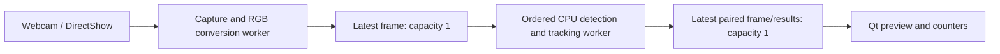

# Live webcam input (0.6)

FrameTrail can now use one Windows DirectShow webcam with the existing CPU detector, tracker, and counting line. Open **Live camera…** from the main window, choose a camera, then **Start camera**. Opening the window lists devices; capture starts only after pressing Start.

## Controls

- **Refresh cameras** updates the device list while stopped. Connect a webcam if the list is empty.
- **Camera default format** uses the driver's default. Optional 640×480 or 1280×720 at 30 FPS requests are available; a camera may reject an unsupported mode. Try its default in that case.
- Set detection, confidence, tracking classes, and crossing direction before Start. Settings are locked during capture.
- **Stop camera** releases the device. Start opens a fresh session with new IDs/counts.
- **Stop & draw line** stops capture and holds the last picture. Click A then B, or right-click to cancel. Press Start when ready.
- Closing requests cancellation and waits for the workers to release the camera.

The first live stage processes frames locally in memory. It does not record the feed or create saved analysis files, so events cannot be replayed later. Network streams and multiple cameras are outside this stage.

## What happens behind the window

FFmpeg's DirectShow adapter opens the selected video device and converts its visual stream to owned RGB24 frames. The existing pinned SDK already includes `libavdevice`; no new SDK download is required.

Capture continues while inference is busy. A new frame replaces an older pending frame, and a new result replaces an older result waiting for display. This bounds application backlog while allowing the display to remain current. It does not guarantee a particular FPS: model cost, camera format, CPU load, driver behaviour, and rendering still matter.

Frames receive increasing capture sequences and monotonic application-arrival timestamps. Skipped frames keep those gaps. The existing tracker uses elapsed time, clears crossing history across gaps longer than 250 ms, and expires stale tracks after 750 ms. It cannot reconstruct movement that was never analysed; fast crossings can be missed under load.

The window reports captured/analysed counts, pending-frame replacements before analysis, replaced preview results, processing milliseconds, and application-arrival-to-display milliseconds. Arrival is measured after capture/decode hands the RGB frame to the application, so the latency figure excludes the camera/driver's earlier delay. Driver-internal dropped frames are not included in application skip counters. FFmpeg's packet buffer is capped at 16 MiB; the application also holds frames in flight, decoder/model buffers, and the displayed image. Queue capacity bounds frame count, not total bytes for every resolution.

## Failures and shutdown

An unavailable camera, access denial, unsupported format, decode error, or ended stream produces a visible error. If a running source provides no packet for five seconds, reading fails with a connection/restart message. Capture uses DirectShow's nonblocking read mode and checks cancellation between polls; inference also receives the stop token. Drivers can still delay device opening or teardown inside their own calls, so a hard shutdown deadline is not promised.

If opening fails, check Windows **Privacy & security → Camera** access for desktop apps, close other applications using the webcam, choose the default format, and retry. Connect/disconnect a device while stopped and use Refresh to update selection.

## Validation and remaining acceptance

The synthetic live test deliberately makes analysis much slower than capture and verifies capacity-one queues, frame replacement, monotonic paired results, bounded observed arrival latency, explicit failures, stop/restart, and source destruction. It also verifies that stationary detections do not invent crossings under frame skipping. This is lifecycle/overload evidence; it is not a hardware performance or counting-accuracy claim.

On 2 October 2026, the integrated webcam passed two short in-memory capture → CPU detection/tracking → stop cycles at its default 1280×720 format. The first cycle captured 45 frames and analysed 42 with three pending-frame replacements; the second captured/analysed 42 with no replacements. Both released the device cleanly. No images or recording were saved. This brief smoke check does not replace a sustained performance/accuracy evaluation. The manual hardware check is deliberately excluded from normal CTest runs.

Before treating the live baseline as validated for a particular camera, run it for several minutes, try Stop/Start and unplug/reconnect, draw a line, and compare crossings against observed movements. Record format, CPU timings, skip rates, memory behaviour, and missed/false events. Representative camera accuracy and a sustained hardware benchmark remain open. This entry into Phase 6 does not remove the recorded-file accuracy checks from the roadmap.

Implementation: `MediaReader(CameraInput)` and `list_cameras()` provide device access; `LiveSession` owns capture, processing, cancellation, and bounded handoff; `LiveWindow` provides controls and frame-aligned counters. See [FFmpeg DirectShow documentation](https://ffmpeg.org/ffmpeg-devices.html#dshow) and the [adapter implementation](https://github.com/FFmpeg/FFmpeg/blob/master/libavdevice/dshow.c) for device selection and nonblocking reads.
