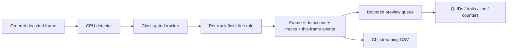

# Object tracking and counting lines (0.4)

Detection answers "what is visible in this frame?" Tracking connects selected detections across frames and assigns a run-scoped ID. A crossing rule uses those observations to count movement through a finite line. This is a native C++ baseline for footage from a stationary camera. It has no extra dependency or service.

## Try the desktop

Build with `./scripts/build.ps1`, then launch `build/windows-msvc/Release/frametrail-desktop.exe` from the repository directory. Open a short recording with **Detect objects** and **Track & count** checked.

1. Choose **People & vehicles**, **People**, or **Vehicles**. The default tracks COCO IDs 0, 1, 2, 3, 5, and 7: person, bicycle, car, motorcycle, bus, and truck. Other detections remain visible without track IDs.
2. The default line spans 10% to 90% of the frame width at half its height. Click **Draw counting line** to freeze the current frame, then click endpoint A and endpoint B on the image. Confirming the line applies it at that position and restores whether playback was playing or paused. Right-click cancels and restores that same playback state without changing the rule. Clicks outside the image and lines shorter than 5% of normalized frame size are ignored.
3. Choose both directions, negative to positive, or positive to negative. The line displays A, B, and side markers. For a left-to-right horizontal line, negative is above and positive is below. Reversing the endpoints reverses the meaning.
4. Changing the line, classes, direction, detection confidence, or tracking setting briefly pauses processing and re-analyses the held frame and bounded buffered frames. It preserves the exact source sequence/timestamp and resumes if previously playing. IDs, trails, and counts reset at that position, so the counters describe the new analysis segment rather than the full recording under mixed settings. Replay starts a fresh source from the beginning. The line remains selected when opening another file, scaled to that file's dimensions.

Boxes show IDs such as `#7`. A question mark marks a tentative track; three nearby matched observations confirm it. A gap over 250 ms makes a retained identity tentative again. Trails contain at most the last 20 observed bottom-center positions. Counters show accepted crossings in each direction; they are counts of crossing events, not unique people. A person can cross repeatedly after re-arming.

Temporal output starts on the second decoded frame. Frame zero seeds the tracker internally, so a one-frame image shows detections only. Predicted-only boxes are never drawn. Processing follows source timestamps and sequence order; playback can slow under CPU inference. Pause and Stop both preserve position and analysis state for Play. Replay starts fresh. Opening another source or closing the window cancels processing.

## CLI analysis and exports

Run from the repository directory, replacing the input with your footage. Create `output` first and choose fresh export filenames:

```powershell
New-Item -ItemType Directory -Path output -Force
.\build\windows-msvc\Release\frametrail.exe inspect "C:\Videos\entrance.mp4" --detect .\models\yolox_nano.onnx --track --classes "0,1,2,3,5,7" --line "0.1,0.5,0.9,0.5" --direction both --tracks output\tracks.csv --events output\events.csv
```

`--direction forward` means negative to positive; `reverse` means positive to negative. `--classes` accepts COCO IDs from 0 through 79. Omitting rule options uses the desktop defaults. The library can disable the counting line while retaining IDs.

Track CSV rows contain frame sequence, optional source timestamp in microseconds, track ID, class/label, confirmation, confidence, and observed pixel box. Event CSV rows contain event ID, confirming frame sequence/timestamp, track ID, class/label, direction, and normalized intersection coordinates. Unknown timestamps stay blank. Event time is the frame where the crossing became observable, not an interpolated claim of the exact physical crossing instant.

IDs are unique only within one run. CLI files represent separate runs; they do not yet contain globally unique run IDs or model/rule metadata. Persistent run identity, saved configuration, thumbnails, and review seeking belong to Phase 5. Exports stream as processing advances; failed runs can leave partial files and return a nonzero exit status. Existing files and output-path collisions are refused.

## Association and bounded state

`Tracker` accepts detections, sequence, optional source timestamp, and dimensions. It never reads pixels or touches Qt. It makes same-class candidate pairs using bottom-center distance and box overlap. Constant-velocity prediction uses elapsed source seconds when timestamps advance, with sequence-step prediction otherwise. The last observed box provides a penalized fallback for abrupt stops/reversals.

In default greedy mode, candidates require normalized distance at most 0.15 and either IoU at least 0.05 or distance within the candidate box's largest normalized dimension (minimum 0.02). A score combines distance scaled by box size and overlap; candidates are greedily assigned in score order, with track index and detection index breaking ties. One observation can match only one track. This is explicitly a deterministic greedy baseline, with no appearance embedding, optical flow, or global assignment solver.

Unmatched tracks remain available for 750 ms since their last detection. If timestamps are missing, they remain for at most 15 sequence steps. Expired tracks are removed; newly created tracks receive fresh monotonically increasing IDs. A frame-size change clears active tracks without reusing IDs. Non-increasing sequences and backward known timestamps fail explicitly rather than bridge incompatible frames.

At most 256 selected detections per frame and 512 active tracks are supported. Exceeding those limits fails with an error instead of silently discarding objects. Trails are capped at 20 points per track. Results contain only the current observations/events and cumulative counters; they do not retain an unbounded event history.

## Crossing semantics

Line endpoints and anchor positions use normalized frame coordinates. The anchor is the box's **bottom center**, chosen as a simple proxy for the object's position on the ground. It is not pose estimation and can move when boxes change. Version 0.11 adds a conservative pixel-aware scene guard outside this tracker; a detected cut resets active IDs/arms while preserving cumulative counts.

The perpendicular signed-distance deadband is 0.015 in normalized coordinates. Observations inside it retain the last stable side. An event requires a confirmed, armed track to move to the opposite stable side, its observed movement segment to intersect the **finite** counting line, and its direction to pass the filter. Moving past an extension beyond the endpoints does not count.

After a side change, the arm is consumed even if direction filtering rejected it. A later observation on the same side at least 0.04 from the line re-arms it. Thus near-line jitter does not immediately create repeat events, while deliberate return crossings remain possible. These distances are baseline parameters, not calibrated accuracy thresholds.

A gap longer than 250 ms between matched observations clears crossing history and trails, even if the identity survives until expiry. With missing timestamps, the threshold is three sequence steps. This avoids inferring a crossing through a long obstruction, at the cost of missing some real crossings. Sparse low-FPS footage may require a measured rule adjustment; we do not fill gaps with invented events.

## Architecture



The desktop snapshots configuration on each analysis revision. Source changes increment the source generation; settings changes increment the analysis revision. Buffered pixels keep their original sequence/timestamp and are re-analysed in order, without seeking or re-decoding from the beginning. Obsolete inference results are rejected. The tracker resets per revision to avoid crossings across different rules. The UI counters use the displayed frame's results, rather than future worker state. PreviewSession retains two-frame result backpressure and a bounded raw-frame backlog for refreshes; see [DEVELOPMENT.md](DEVELOPMENT.md).

## Evidence and remaining work

Synthetic contract checks cover confirmation, single/reverse/repeat crossings, finite endpoints, diagonal lines, endpoint ordering, jitter, brief misses, long obstruction, expiry, class isolation, nearby/overlapping objects, one-to-one association, variable-rate timestamps, missing timestamps, resolution changes, invalid input, and bounded trails.

Integration checks run the actual ONNX model on repeated and vertically translated reference photos. They verify retained IDs, confirmation, one finite-line event with frame/timestamp identity, and direction filtering in CSV. They also reject invalid CLI settings/output collisions and verify that still images have no temporal output. Worker tests cover paired tracking/frame identity and source replacement. Qt checks render IDs/trails/line markers and exercise letterbox-aware line selection, rejection, and cancellation. Those checks validate implementation contracts; controlled photo motion is not real-world tracking evaluation.

Before claiming useful counting accuracy, evaluate short permissioned clips from a fixed camera: one person crossing, a vehicle crossing, motion in both directions, repeated crossings, jitter/standing near the line, obstruction, and nearby similar objects. Label expected crossings and identities, then report missed events, false events, duplicates, and identity switches with model/line/settings/input details. Camera motion, crowds, small objects, detector class flicker, and occlusion can still break this baseline.

First compare those cases with the current detector/tracker before changing algorithms or adding GPU/training infrastructure. Version 0.5 saves whole-file runs and supports event review; see [saved runs](SAVED_RUNS.md). Use that workflow to preserve settings/evidence during evaluation. See roadmap and compute/training gates.

## Reliability stage in 0.11

Default association stays greedy after experimental global repair introduced an extra sampled crowd ID change. Repair is available explicitly through the CLI, while the GUI gains native scene-boundary handling and long-gap reconfirmation. See tracking evaluation and evidence for module boundaries, measured failures, limits and the reviewed-label workflow.
