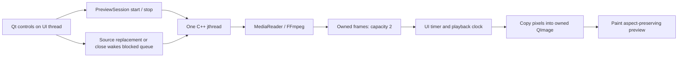

# Build and understand FrameTrail

## What runs today

FrameTrail 0.6 has a desktop preview, live camera window, saved-analysis review, and command-line inspector backed by a reusable C++ library. Local files and one Windows webcam produce owned RGB24 pixels. Whole-file analysis stores settings/events in SQLite; saved review plays the source without inference. See [live camera](LIVE_CAMERA.md) for device controls and bounded live processing.

The preview has Open media, Play/Pause, Stop, Replay, Video analysis, and Live camera. CPU detection adds boxes/labels; [tracking](TRACKING.md) adds IDs and crossings; [video analysis](SAVED_RUNS.md) adds direct recorded-video intake, timestamped appearances, persistent evidence and review. Audio playback, live recording, and agents remain planned. CLI throughput includes enabled stages; it is not a live-performance promise.

## Windows setup

Requirements: Windows x64, Visual Studio 2022 with Desktop development with C++ and its Windows SDK, CMake 3.25 or newer, and PowerShell. The scripts discover Visual Studio's bundled CMake without changing PATH.

From the FrameTrail repository directory:

```powershell
.\scripts\fetch-dependencies.ps1
.\scripts\build.ps1
.\build\windows-msvc\Release\frametrail-desktop.exe
```

Fetching downloads approximately 81 MB of FFmpeg and 40 MB of Qt base into `.deps/`, verifies SHA-256 hashes, and extracts the SDKs. CMake handles Qt's 7z archive. It also fetches ONNX Runtime (about 83 MB), YOLOX-Nano (about 3.6 MB), and SQLite source (about 3 MB). Nothing is installed system-wide. Building configures x64, compiles Release, copies runtime DLLs/plugins, and runs CTest. With the model and optional detection sample, twenty-two checks are available. Existing checkouts can fetch only the new source with `.\scripts\fetch-storage.ps1`.

For Debug:

```powershell
.\scripts\build.ps1 -Configuration Debug
```

To build only the core and CLI without acquiring Qt (CPU detection remains included):

```powershell
.\scripts\fetch-dependencies.ps1 -MediaOnly
.\scripts\build.ps1 -MediaOnly
```

## Opening a fresh copy in VS Code

Each clone needs its own SDKs: `.deps/` is ignored by Git. Selecting a compiler/preset does not download dependencies. Run `./scripts/fetch-dependencies.ps1` before the first configure.

Choose **Windows x64 (Visual Studio 2022)** (`windows-msvc`). Visual Studio supplies the compiler; VS Code is the editor. Run **CMake: Configure**, choose the `release` or `debug` build preset, and run **CMake: Build**. Select `frametrail-desktop` as the launch target. The [CMake Tools preset guide](https://github.com/microsoft/vscode-cmake-tools/blob/main/docs/cmake-presets.md) explains these commands.

If paused inside `CMakeLists.txt` on a `find_path` error, stop the CMake debugging session, fetch dependencies, and configure normally. Missing `libavcodec/avcodec.h` means the FFmpeg development SDK is absent or `FFMPEG_ROOT` is wrong. Installing only `ffmpeg.exe` does not provide development headers/libraries. Missing `Qt6Config.cmake` requires the Qt SDK too.

The build script performs configure/build/checks together. Stop any active CMake session before running it against the same build directory.

If CMake is on PATH, manual equivalents are:

```powershell
cmake --preset windows-msvc
cmake --build --preset release
ctest --preset release
```

Custom compatible SDKs can be specified through `-DFFMPEG_ROOT=<ffmpeg-directory>` and `-DFRAMETRAIL_QT_ROOT=<qt-directory>`. CLI-only configuration uses `-DFRAMETRAIL_BUILD_GUI=OFF`. The convenience build script intentionally uses the manifests' SDK paths and refreshes both root paths on each configure.

## Using the desktop

Use **Open media** to select a local file. Videos start automatically. **Pause** and **Stop** hold the current position; **Play** resumes from there with the same analysis state. **Replay** starts the same source from the beginning. Settings changes re-analyse the held frame and buffered backlog at the same sequence/timestamp, then restore whether playback was playing or paused. Counts and IDs start a new analysis segment at that point. Line drawing holds the frame until you confirm A/B or right-click to cancel. Opening another file cancels the old worker before starting the new source. Closing requests cancellation and waits for the worker without blocking the UI event thread.

The window shows dimensions, codec, zero-based frame number, and source-relative timestamp. A synthetic example is available after tests generate the fixtures:

```powershell
.\build\windows-msvc\Release\frametrail-desktop.exe .\build\windows-msvc\fixtures\variable.mkv
```

This test pattern is deliberately tiny (64x48, ten frames), so enlarging it looks pixelated. Try a real recording for a useful preview. Playback uses decoded presentation timestamps and preserves order. If decoding falls behind, playback slows instead of dropping frames. Unknown timestamps use an approximately 30 FPS display fallback but remain unknown in the frame contract and CSV. Still images remain displayed after the source finishes.

## Using the inspector

```powershell
.\build\windows-msvc\Release\frametrail.exe --help
.\build\windows-msvc\Release\frametrail.exe inspect .\build\windows-msvc\fixtures\variable.mkv
New-Item -ItemType Directory -Path output -Force
.\build\windows-msvc\Release\frametrail.exe inspect "C:\Videos\entrance.mp4" --csv output\frames.csv --preview output\first-frame.ppm --max-frames 100
```

Replace the example input with your recording. Output directories must exist; existing output files are refused. Choose fresh names for subsequent exports. A failed decode/write may leave partial output, and a nonzero exit status indicates failure.

Without `--max-frames`, inspection reads to EOF. `timestamp_us` is source-relative presentation time in microseconds (one million per second); unknown timing stays blank. Initial metadata dimensions may differ from individual frames. The desktop can open the exported PPM image.

## Source map

| Location | Responsibility |
| --- | --- |
| `include/frametrail/frame.hpp` | Sequence, optional timestamp, dimensions, stride, owned pixels |
| `include/frametrail/media_reader.hpp`, `src/media_reader.cpp` | Local file validation, FFmpeg ownership, decoding/flushing, timing, RGB conversion |
| `src/frame_export.cpp` | PPM writing with row padding |
| `include/frametrail/preview_session.hpp`, `src/preview_session.cpp` | Worker lifecycle, cancellation, bounded queue, status, source generations |
| `apps/desktop/preview_window.cpp` | Controls, playback clock, generation checks, image ownership, painting |
| `apps/desktop/main.cpp` | Qt entry point and optional initial file argument |
| `apps/cli/main.cpp` | Arguments, export validation, frame loop, CSV, summary |
| `include/frametrail/detector.hpp`, `src/detector.cpp` | Model session, preprocessing, grid decoding, NMS, labels, and CPU timings |
| `include/frametrail/tracker.hpp`, `src/tracker.cpp` | Motion/overlap association, confirmation/expiry, bounded trails, finite-line crossing state and counters |
| `include/frametrail/run_store.hpp`, `src/run_store.cpp` | SQLite C API ownership, frozen run schema, transactional events/progress, read-only pages/CSV |
| `include/frametrail/analysis_job.hpp`, `src/analysis_job.cpp` | Whole-file decode/detect/track/persist worker, progress and partial cancellation/failure |
| `apps/desktop/saved_run_window.cpp` | Saved run workflow, thumbnails/pages/markers, asynchronous decode-only event review |
| `include/frametrail/live_session.hpp`, `src/live_session.cpp` | Independent capture/analysis, latest-frame handoff, arrival timing, skip metrics, lifecycle |
| `apps/desktop/live_window.cpp` | Camera selection, live overlays/counts, stop/draw/restart and diagnostics |
| `tests/` | Synthetic fixtures, media/CLI/worker/desktop behaviour checks |
| `scripts/` | Explicit dependency acquisition and build/check commands |
| `dependencies/` | Pinned FFmpeg, Qt, ONNX Runtime, model, and SQLite source artifacts |

FFmpeg is a C library called directly from our C++ code. RAII wrappers release native contexts, packets, frames, and conversion resources even when an operation fails. Returned frames own their pixels and remain valid when the reader advances. At EOF the reader flushes delayed decoder output, which matters for codecs that reorder frames internally.

## Worker, timing, and ownership



With detection enabled, the same worker runs inference after decoding. With tracking enabled, it then updates the source's tracker and crossing rules, and enqueues the frame with detections/tracks/events/counters. The worker never touches Qt widgets. A mutex protects status and the queue. A stop-aware condition variable waits when the queue is full; the UI polls without waiting for frames. Pause and the player Stop leave a bounded backlog instead of decoding the entire recording into memory. Counts shown by the UI belong to the displayed frame.

Each source start increments a generation ID. Each settings change increments an analysis revision. The UI returns its displayed/pending raw frames; the controller merges them with queued raw pixels in source order, de-duplicates sequences, and rejects obsolete results. The worker applies the latest settings before processing that backlog, resets tracking, and retains the decoder's current position. Rapid changes coalesce into the latest revision. The detector is reused when its settings are unchanged. At EOF a later revision can refresh the held frame using a successor worker and the retained reader, without re-opening the source.

Source replacement waits for the previous worker to become inactive and joins it before starting another. `PreviewSession::stop()` is internal cancellation for replacement/close, not the player's Stop button. It requests the source and worker stop tokens, clears queued frames, and wakes the producer. `std::jthread` is the last session member so destruction joins before reader/synchronization objects disappear. The reader retains the source handle at EOF until replacement/close. Decoding can finish before playback: the UI reaches Finished only after the accepted frames are displayed.

The result queue holds at most two frames. Normal playback also holds one pending presentation frame, one displayed raw RGB frame for refreshes, and its QImage. During reconfiguration the ordered raw backlog is capped at five frames (displayed, pending presentation, two queued, and one in-flight); results and in-flight work move through that backlog rather than accumulate a recording. A retained displayed copy, inference/model buffers, decoder/conversion buffers, and temporary copies add memory. This bounds frame count, not bytes: larger resolutions use more memory. The deliberate QImage copy prevents dangling pixels. Profiling may justify reducing copies later.

Source presentation timestamps govern playback; a steady clock measures elapsed playback time. Pause shifts the playback clock's anchor. The reader is sequential and must not be read concurrently. Its stop token interrupts FFmpeg I/O; the CLI currently relies on OS process interruption rather than a graceful interactive cancel command.

## Checks and limitations

The original six checks cover fixture generation, media contracts, CLI help, CLI exports, preview lifecycle, and desktop controls. Detection and tracking add the contracts/integration described in their guides. Media checks verify colour/layout, retained ownership, delayed EOF, variable timing, cancellation, invalid/audio-only inputs, Unicode paths, and padded export. Worker checks cover bounds, blocked-producer cancellation, generation/revision identity, repeated reconfiguration, exact sequence/timestamp/pixels, no re-decoding, EOF/still refreshes, failure recovery, and shutdown. Desktop checks exercise Stop/Play continuity, paused/playing settings, line apply/cancel, confidence/classes/direction/detection/tracking toggles, rapid changes, replay, source replacement, errors, and closing during work.

Desktop checks use Qt's offscreen platform and load the installed Windows Segoe UI font for readable screenshots. The rendered window was inspected, but native file-dialog interaction and representative long recordings still need manual checks. No leak detector or sustained live-input test has been run. Windows x64 is the verified platform.

Event review seeking is implemented, with sequence fallback when timestamps/indexes are unsuitable. Audio, general player scrubbing, rotation metadata, and non-square sample aspect-ratio correction remain unimplemented. The canvas preserves pixel-dimension aspect ratio. Supported codecs depend on FFmpeg; every format has not been verified. Memory growth and representative performance still need measurement.

## Dependency provenance

FFmpeg is an LGPL-shared 8.1 branch build from [BtbN/FFmpeg-Builds](https://github.com/BtbN/FFmpeg-Builds). The pinned September 2026 monthly build has longer retention than daily archives, but availability is finite. Qt 6.11.3 base comes from the [official SDK repository](https://download.qt.io/online/qtsdkrepository/windows_x86/desktop/qt6_6113/). Neither script silently falls back to an unpinned latest archive.

Licenses/notices remain inside `.deps`. Local development builds do not complete the distribution milestone; packaging needs the selected binaries' notices and licensing review. See [equipment and setup](EQUIPMENT_AND_SETUP.md).

## Next slice

Evaluate recorded/live detection and crossings using [TRACKING.md](TRACKING.md), [SAVED_RUNS.md](SAVED_RUNS.md), and [LIVE_CAMERA.md](LIVE_CAMERA.md). Profile sustained resource use before optimization/packaging. Optional AI perception and an agent-driven service remain deferred.

The main layout is `apps/desktop/preview_layout.ui` (Qt Designer), compiled by CMake AUTOUIC. All desktop windows share `theme.hpp`. Use `scripts/profile.ps1` for file-only stage measurements and `scripts/package.ps1` / `scripts/check-package.ps1` for private Windows deployment checks. Never invoke `--camera-smoke` without explicit user consent to activate the camera.

## Recorded analysis in 0.9

`SavedRunWindow` owns intake/settings, a temporary analysis workspace, `AnalysisJob`, and a separate decode-only review session. The GUI prepares `RunKind::appearances` with all 80 categories and no line. `AnalysisJob` processes ordered frames and passes `TrackingResult::objects` into `RunStore::record_frame`. SQLite updates first/last observations and retains first-frame thumbnails; the UI polls one owned preview snapshot and pages at most 100 stored entries.

Save/export are post-analysis actions using `QSaveFile` with direct-write fallback disabled. The source/model/working database are protected, existing-file replacement goes through the normal save dialog, and unsaved results have a Save/Discard/Cancel choice. `PreviewSession::release()` closes an inactive review reader on final close without changing the main player's resumable Stop semantics. Schema 3 supports appearances, while versions 1/2 retain their original crossing review.

Run `scripts/build.ps1` for the 26-check native/desktop suite. `desktop_analysis_intake` covers the new flow; `saved_run_contract`, `saved_analysis_inference` and `desktop_saved_review` cover storage, real inference and compatibility. See [video analysis](SAVED_RUNS.md) for usage, exported columns and prediction limitations.

## GPU module in 0.10

`DetectorOptions` adds backend preference and an optional DXGI adapter index. `DmlInference` binds the separately loaded runtime's C API and RAII resources; the existing linked CPU C++ adapter retains its original ownership. Per-frame `ExecutionInfo` propagates through preview/live results and optional run metadata. Geometry, tracker, queue limits and saved-analysis interaction remain shared.

Fetch with `scripts/fetch-gpu.ps1`, then `scripts/build.ps1 -GpuChecks` for all 31 native/desktop checks on capable hardware. The ordinary build has 27 checks and can omit GPU dependencies; `FRAMETRAIL_ENABLE_DIRECTML=OFF` tests a CPU-only build. Run `scripts/compare-backends.ps1` for serial, hash-checked local measurements. See [GPU inference](GPU_INFERENCE.md).

## Tracking evaluation in 0.11

`frame_tracker.hpp` composes scene continuity with the pixel-independent tracker. `src/assignment.*` isolates the bounded experimental assignment solver. `scripts/evaluate-tracking.py` scores original-frame reviewed labels against native temporal CSV exports; Python is development tooling only. Profile CSV appends three scene fields. Run the 34-check native/GPU suite with `scripts/build.ps1 -GpuChecks` and the 16 Python scorer checks with `python -B -m unittest discover -s tests -p "test*evaluation.py"`. See [labels, evidence and limits](TRACKING_EVALUATION.md).


## Expanded recognition adapters (0.12)

The source/CLI supports `--model-type world-s`, `world-m` and `openimages`. Use the pinned optional export environment and commands in [RECOGNITION.md](RECOGNITION.md), then rebuild. The shipped app remains C++ and needs no Python service. New contracts use RGB/255 and centered letterboxing rather than YOLOX's BGR/grid convention. Stable canonical IDs are defined by `dependencies/recognition-vocabulary.json` and checked against `src/recognition_vocabulary.hpp` by the registry test. New saved runs use schema 4; do not relabel legacy evidence.

With all five models and the optional runtime installed, `scripts/build.ps1 -GpuChecks` passes 45 native/desktop checks; Python standard-library scorer/registry discovery passes 18. `scripts/check-recognition.py` is an optional developer reference/metadata-rejection check and uses the export environment. Hardware tests and public reference data remain opt-in; a clean checkout's base suite does not require all expanded models.
